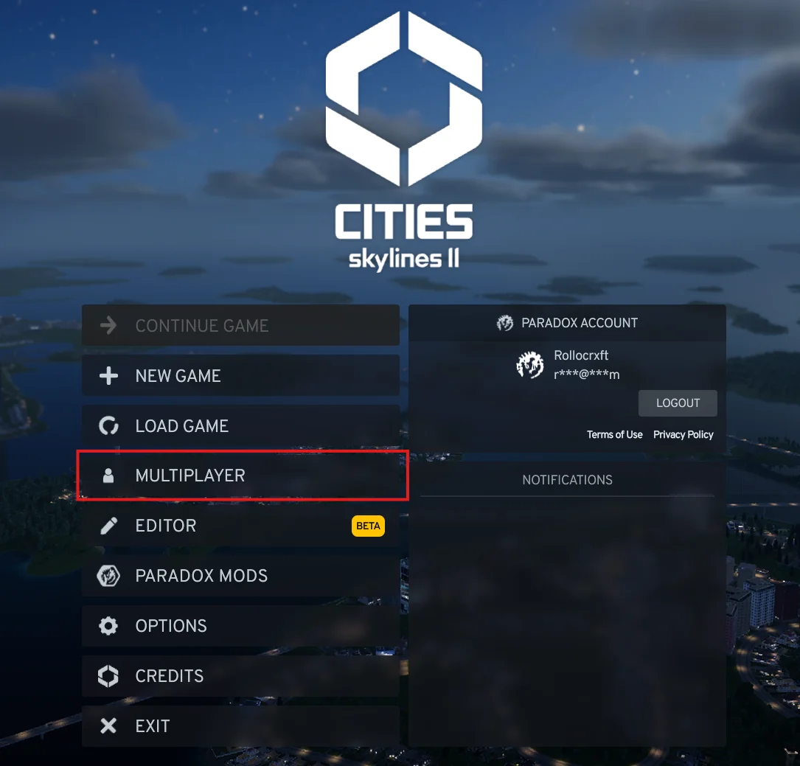
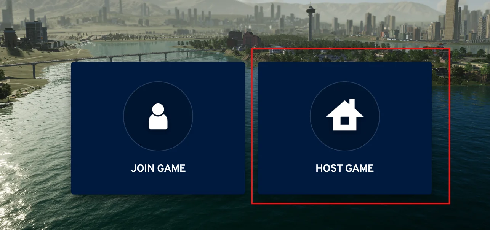
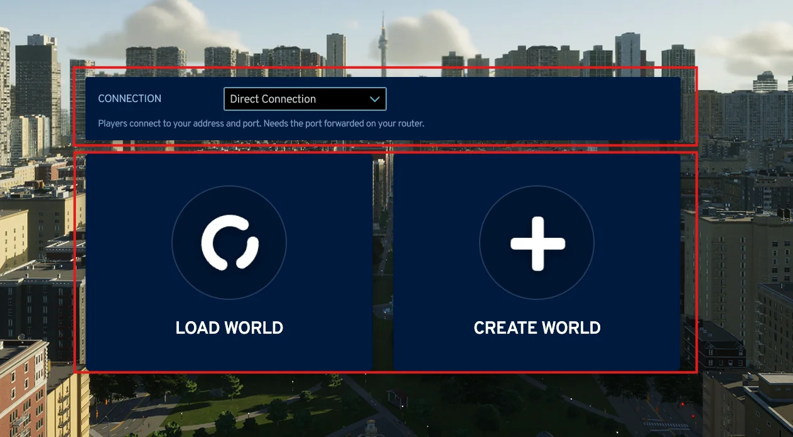
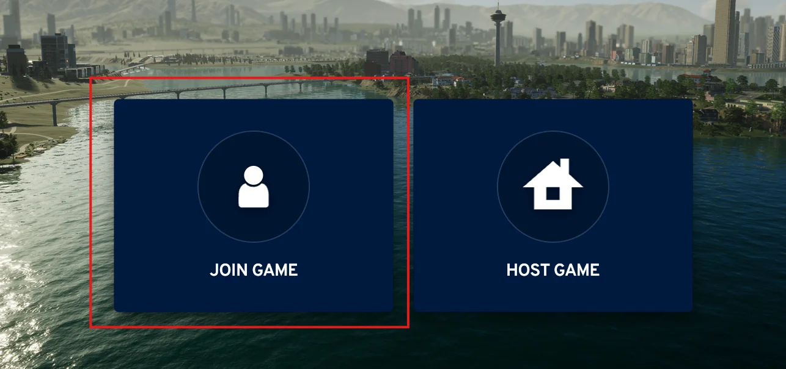
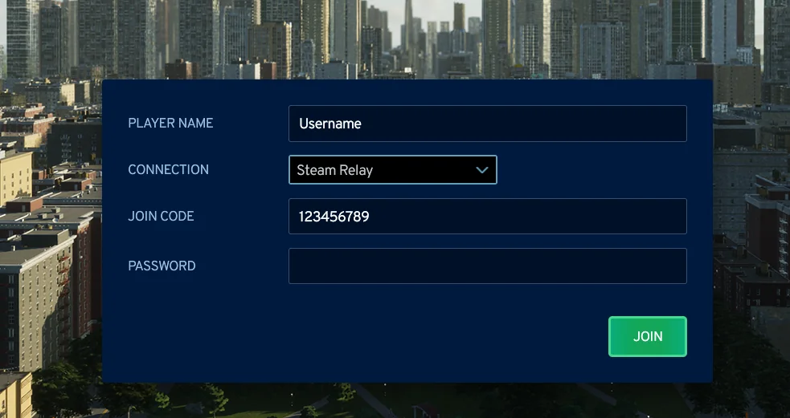

# Steam Relay

## Requirements

- The Steam copy of Cities: Skylines II, launched through Steam, with Steam online.
- Both players choose Steam Relay. The mode has to match.

Xbox App, Microsoft Store and Game Pass copies cannot use the relay. Those players use a
[direct connection](direct-connection.md) instead.

## Hosting with a relay

1. Open Multiplayer and click Host Game.

2. Set the connection type to Steam Relay.
3. Your join code appears there. Click it to select it, then press <kbd>Ctrl</kbd>+<kbd>C</kbd>.

4. Load or create your world as usual. The session starts once the city has loaded.
5. Send the code to your friends.

## Joining with a code

1. Open Multiplayer and click Join Game.

2. Set the connection type to Steam Relay.
3. Paste the code into the join code field, enter your player name and the password if the
   host set one.

4. Click Join and wait while the host's city downloads.

## Public lobbies

A Steam host can list their city so anyone can find it, without sharing a code.

**Listing your city:** on the Host screen (or in the in-game multiplayer panel before you start
hosting), turn on **List Publicly** and give the lobby a name. Listing starts off every time the game starts, so you
choose it again for each session. **Approve Players** is always on
for a listed city, so nobody gets in without your OK. Directly below, **Require a Join Message**
makes players from the list write a short note (up to 160 characters) that you read in the join
request before you accept or decline.

**Joining a listed city:** open Multiplayer and click **Public Lobbies**.
Pick a city and click Join. If the host set a password or requires a message, you enter it first.

**Your IP address stays private.** The list stores only the lobby name, player count and
settings, never an address. Players who join from the list always connect through the Steam
relay, never directly, so they do not see your IP address, not before and not after you accept
them. The same goes the other way: you do not see theirs.

**We recommend Steam Relay for public hosting.** Listing also works with a direct connection,
and players from the list still come in through the relay. But a direct host keeps its port open
to the internet, and anyone who has your address can reach it there.

If you decline a join request, that player cannot ask again for a few minutes. The join message
is shown as plain text only, and anything that could disguise it is removed.

## When the code is unavailable

If the host screen shows "Unavailable - start the game through Steam", one of these is
true:

- The game was not launched through Steam, or Steam is offline. Close the game, start
  Steam, and launch the game from there.
- The installation is not the Steam version. Use a [direct connection](direct-connection.md).

If the relay refuses to start or drops repeatedly, restart Steam and the game. If it keeps
failing, both players can switch to a direct connection.

More relay messages are listed under
[Steam Relay is unavailable or the join code is invalid](errors-and-warnings.md#steam-relay-is-unavailable-or-the-join-code-is-invalid).
